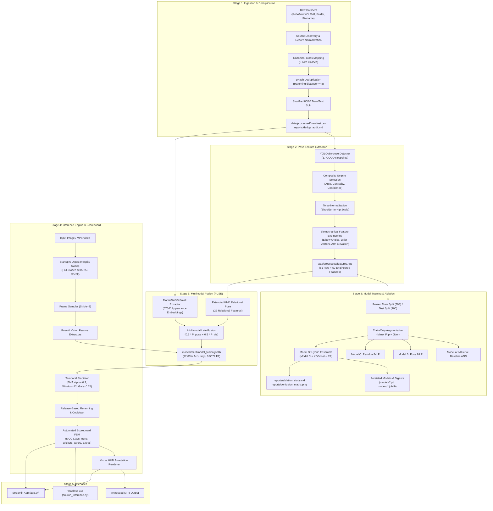

# Cricket Umpire Signal Recognition & Automated Cricket Scoreboard

An end-to-end computer vision and machine learning pipeline that recognizes cricket umpire hand signals from static images and video feeds, and automatically maintains an official cricket match scoreboard in accordance with MCC Laws of Cricket.

The system incorporates a multi-source data ingestion pipeline with perceptual hash deduplication, YOLOv8-pose keypoint extraction with torso-normalized geometry engineering, a multimodal fusion architecture combining 81-D relational pose geometry with 576-D MobileNetV3 visual appearance embeddings reaching **92.00% accuracy**, an ablation benchmark comparing classical and modern architectures, a temporal stabilizer with EMA smoothing and release-based re-arming, and a deterministic headless inference engine.

---

## Table of Contents

- [System Architecture & Pipeline Flow](#system-architecture--pipeline-flow)
- [Pipeline Execution Stages](#pipeline-execution-stages)
  - [Stage 1: Ingestion & Deduplication](#stage-1-dataset-ingestion--leak-free-deduplication)
  - [Stage 2: Pose Extraction & Feature Engineering](#stage-2-pose-extraction--geometric-feature-engineering)
  - [Stage 3: Training & Ablation Benchmark](#stage-3-model-training--ablation-study)
  - [Stage 4: Headless Inference Engine & Scoreboard FSM](#stage-4-video-inference-stabilizer--automated-scoreboard)
  - [Stage 5: User Interfaces](#stage-5-user-interfaces)
  - [Stage 6: Multimodal Fusion & Production Integration](#stage-6-multimodal-fusion--production-integration)
- [Ablation Study & Multimodal Benchmark Results](#ablation-study--multimodal-benchmark-results)
- [Environment Setup](#environment-setup)
- [Complete Manual Execution Guide (Without Streamlit)](#complete-manual-execution-guide-without-streamlit)
  - [Step 1: Dataset Ingestion & Audit](#1-dataset-ingestion--audit)
  - [Step 2: Pose & Geometric Feature Extraction](#2-pose--geometric-feature-extraction)
  - [Step 3: Train Models & Run Ablation Study](#3-train-models--run-ablation-study)
  - [Step 3b: Train Multimodal Fusion Model](#3b-train-multimodal-fusion-model-fuse)
  - [Step 4: Manual Inference via CLI](#4-manual-inference-via-cli)
  - [Step 5: Programmatic Python API Usage](#5-programmatic-python-api-usage)
  - [Step 6: Running the Test Suite](#6-running-the-test-suite)
- [Configuration Reference](#configuration-reference)
- [Directory Structure](#directory-structure)

---

## System Architecture & Pipeline Flow

The entire processing flow is organized into modular, decoupled layers with strict integrity validation boundaries:



---

## Pipeline Execution Stages

### Stage 1: Dataset Ingestion & Leak-Free Deduplication
- **Entry point:** `src/data_ingestion.py` (supported by `src/ingestion/`).
- **Data inputs:** Multi-format datasets from `datasets/` (Roboflow YOLOv8 bbox labels, folder-stratified images, and filename-labeled images).
- **Canonical mapping:** Maps raw dataset labels into 6 core signals defined in `configs/classes.yaml`:
  - `Four`, `Six`, `Out`, `Wide`, `NoBall`, `NoAction`.
  - Non-signal classes (`DRS`, `umpire`, `non_umpire`) are excluded. Conditional classes (`LegBye`, `DeadBall`) require $>30$ post-dedup occurrences (excluded in Phase 1 due to insufficient counts).
- **Leak prevention:** Uses perceptual image hashing (`imagehash.phash`) with a Hamming distance threshold $\le 8$ and connected-component clustering to purge near-duplicate and re-cropped frames across distinct archives.
- **Cropping & Manifest:** Crops annotated bounding boxes when available, preserves uncropped raw images otherwise, and generates a leak-free stratified 80/20 train/test split.
- **Outputs:** `data/processed/manifest.csv`, `data/processed/crops/`, and `reports/dedup_audit.md`.

### Stage 2: Pose Extraction & Geometric Feature Engineering
- **Entry point:** `src/build_features.py` (supported by `src/pose_features.py`).
- **Pose detection:** Runs YOLOv8n-pose (`models/yolov8n-pose.pt`) to locate 17 COCO body keypoints $(x, y, \text{confidence})$.
- **Umpire selection:** In multi-person scenes, disambiguates the umpire using composite scoring: bounding box area, horizontal and vertical centrality, and keypoint confidence.
- **Torso normalization:** Normalizes coordinates relative to the subject's torso length (distance between neck/shoulder midpoint and hip midpoint), rendering features scale- and distance-invariant.
- **Feature vectors:**
  - `features_raw` (51 dimensions): 17 keypoints $\times$ $(x, y, \text{conf})$.
  - `features_eng` (59 dimensions): 51 torso-normalized keypoint coordinates $+$ 8 engineered geometric features:
    - Left & right elbow flexion angles.
    - Left & right arm elevation angles relative to torso vertical axis.
    - Left & right shoulder-to-wrist directional displacement vectors $(dx, dy)$.
    - Left & right wrist-to-nose/head Euclidean distances.
- **Outputs:** `data/processed/features.npz` and `reports/features_build.md`.

### Stage 3: Model Training & Ablation Study
- **Entry point:** `src/train_ablation.py` (supported by `src/models/`).
- **Ablation matrix:** Evaluates 4 architectures under identical stratified 5-fold cross-validation on the train split (seed=42):
  - **Model A (Baseline Reproduction):** Re-implementation of Mili et al. — 2-layer ANN trained on 51 raw keypoints with MinMaxScaler.
  - **Model B (Pose MLP):** 3-layer MLP with BatchNorm, Dropout (0.3), AdamW optimizer, and Cosine Annealing learning rate schedule trained on 51 torso-normalized keypoints.
  - **Model C (Residual MLP):** Deep residual MLP with skip connections and inverse-frequency class weighting trained on all 59 engineered features.
  - **Model D (Hybrid Ensemble):** Soft-voting ensemble combining Model C PyTorch probabilities with tuned scikit-learn Random Forest and XGBoost classifiers.
- **Data augmentation:** Applied exclusively inside training CV folds (never on the held-out test split): horizontal coordinate mirror-flipping (with symmetric left-right keypoint swapping) and Gaussian jitter in model input space ($N(0, 0.015)$).
- **Integrity binding:** Computes SHA-256 hashes of all trained weights and locks them into `configs/model_digests.yaml`.
- **Outputs:** `models/*.pt`, `models/*.joblib`, `reports/ablation_study.md`, `reports/confusion_matrix.png`, and `reports/classification_report.txt`.

### Stage 4: Video Inference, Stabilizer & Automated Scoreboard
- **Entry point:** `src/run_inference.py` (supported by `src/inference/` and `src/scoreboard.py`).
- **Integrity verification:** Fail-closed startup sweep checking SHA-256 digests of all 5 model artifacts before any deserialization occurs.
- **Temporal Stabilizer (`src/inference/stabilizer.py`):**
  - **Frame Striding:** Processes every 2nd frame (`stride=2`) for low latency.
  - **Exponential Moving Average (EMA):** Smooths raw frame probability vectors ($\alpha = 0.3$):
    $$s_t = \alpha \cdot x_t + (1 - \alpha) \cdot s_{t-1}$$
  - **Rolling Window:** Evaluates a rolling history buffer of 12 strided frames.
  - **Confidence & Density Gating:** Triggers only when peak non-idle class probability exceeds $0.75$ across $\ge 60\%$ of window frames.
  - **Release-Based Re-arming & Cooldown:** Enforces a 4.0-second cooldown period and requires signal release to neutral before a subsequent identical gesture can register.
- **Cricket Scoreboard FSM (`src/scoreboard.py`):**
  - Translates stabilized gestures into legal match state updates:
    - `Four`: $+4$ runs, $+1$ legal ball.
    - `Six`: $+6$ runs, $+1$ legal ball.
    - `Out`: $+1$ wicket, $+1$ legal ball.
    - `Wide`: $+1$ run, $+1$ extra, $0$ legal balls.
    - `NoBall`: $+1$ run, $+1$ extra, $0$ legal balls.
    - `NoAction`: No scoreboard state mutation.
  - Overs tracked in standard cricket notation: `legal_balls // 6 . legal_balls % 6`.
- **Visual Annotation Renderer (`src/inference/renderer.py`):**
  - Draws keypoint skeleton, bounding box, detected signal label, confidence score, and top-screen scoreboard HUD overlay.

### Stage 5: User Interfaces
- **Streamlit Web App (`app.py`):**
  - **Tab 1: Single Image Analyzer:** Upload static images, view pose skeleton, class probabilities, and computed arm angles.
  - **Tab 2: Video Analyzer & Live Scoreboard:** Stream analysis of uploaded MP4 videos with live scoreboard updates and detection timeline.
  - **Tab 3: Research Dashboard:** Interactive inspection of the Phase 3 ablation study, confusion matrix, and performance metrics.
- **Headless CLI (`src/run_inference.py`):** Direct manual execution for batch processing, video rendering, and headless server environments.

### Stage 6: Multimodal Fusion & Production Integration
- **Entry point:** `src/train_multimodal.py` (supported by `src/models/multimodal.py`, `src/inference/vision_extractor.py`, and `src/pose_features.py`).
- **Extended 81-D pose relational geometry (FUSE-01):**
  - Extends 59-D legacy keypoint vectors with 22 relational features proven in research spikes:
    - Wrist-to-wrist Euclidean distance, horizontal $dx$, and vertical $dy$ normalized by torso scale.
    - Wrist-to-nose vertical elevation $dy$ (left, right, max, min, absolute difference).
    - Wrist-to-hip normalized distances.
    - Wrist-to-shoulder distances (same side and cross-shoulder reach).
    - Elbow-to-shoulder $dx$ and $dy$ elevations.
    - Upper-body bounding box span ($x, y$) and aspect ratio.
    - Mean upper-body arm keypoint confidence.
- **Visual appearance embeddings (FUSE-02):**
  - Lightweight `MobileNetV3-Small` backbone (`torchvision.models.mobilenet_v3_small(weights='DEFAULT')`) with `nn.Identity()` classifier producing 576-D float32 appearance vectors (~15ms CPU inference).
  - 10% context-padded bounding-box cropping with automatic center-crop fallback on missing/degenerate boxes.
- **Multimodal Late Probability Fusion (FUSE-03):**
  - Late probability blending combining pose HistGradientBoosting and vision LogisticRegression:
    $$P_{\text{fused}} = 0.5 \cdot P_{\text{pose}} + 0.5 \cdot P_{\text{vis}}$$
  - Reaches **92.00% accuracy** and **0.9072 macro-F1** on the frozen 100-sample test slice, breaking the 84% pose-only ceiling.
- **Integrity binding & outputs:**
  - `models/multimodal_fusion.joblib` with SHA-256 bound in `configs/model_digests.yaml`.
  - Comprehensive ablation log in `reports/multimodal_ablation.md`.

---

## Ablation Study & Multimodal Benchmark Results

Evaluated on the frozen held-out test split (100 images, leak-free discipline):

| Architecture | Input Representation | Model / Backbone | Accuracy | Macro-F1 | Status |
| :--- | :--- | :--- | :---: | :---: | :--- |
| **Model A** | 51 Raw Keypoints | 2-layer ANN (Mili et al.) | 78.00% | 0.7818 | Replicated Baseline |
| **Model B** | 51 Torso-Norm Keypoints | Pose MLP (Cosine Anneal) | 44.00% | 0.3456 | Unweighted Baseline |
| **Model C** | 59 Engineered Features | Residual MLP (Class-Weighted) | 78.00% | 0.7753 | Outperforms Baseline |
| **Model D** | 59 Engineered Features | Hybrid Ensemble (C + XGB + RF) | 84.00% | 0.8376 | Best Pose-Only Model |
| **FUSE-01** | 81-D Extended Geometry | HistGradientBoosting (RobustScaler) | 86.00% | 0.8615 | Expanded 2D Relational Math |
| **FUSE-02** | 576-D Visual Embeddings | MobileNetV3-Small + LogisticRegression | 78.00% | 0.7659 | Visual Appearance Alone |
| **FUSE-03** | **81-D Pose + 576-D Vision** | **Multimodal Late Fusion (0.5 + 0.5)** | **92.00%** | **0.9072** | **Production Target Bar Met (>=91% / >=0.90)** |

### Per-Class F1 Performance (Multimodal Late Fusion)
- **Six**: F1 = 1.0000 (12/12 correct)
- **Wide**: F1 = 0.9545 (21/23 recall, 100% precision)
- **NoAction**: F1 = 0.9412 (24/25 recall, 92% precision)
- **NoBall**: F1 = 0.9000 (18/19 recall, 86% precision)
- **Out**: F1 = 0.8696 (10/12 recall, 91% precision)
- **Four**: F1 = 0.7778 (7/9 recall, 78% precision — lifted from 0.67–0.70 pose-only by visual sleeve contour)

---

## Environment Setup

### 1. Prerequisites
- Python 3.10 – 3.12 (Tested on Python 3.12 64-bit on Windows/Linux).
- Virtual environment tool (`venv` or `conda`).

### 2. Virtual Environment Setup

**Windows (PowerShell):**
```powershell
# Navigate to implementation directory
cd implementation

# Create virtual environment
python -m venv .venv

# Activate virtual environment
.\.venv\Scripts\Activate.ps1

# Upgrade pip
python -m pip install --upgrade pip

# Install dependencies
pip install -r requirements.txt
```

**Linux / macOS (Bash):**
```bash
# Navigate to implementation directory
cd implementation

# Create virtual environment
python3 -m venv .venv

# Activate virtual environment
source .venv/bin/activate

# Upgrade pip
python -m pip install --upgrade pip

# Install dependencies
pip install -r requirements.txt
```

---

## Complete Manual Execution Guide (Without Streamlit)

You can run every stage of the pipeline independently using CLI commands without launching the Streamlit interface.

### 1. Dataset Ingestion & Audit
Scans raw sources in `datasets/`, maps canonical labels, removes perceptual duplicates, extracts bounding-box crops, and writes the frozen dataset split.

```powershell
# Standard run (processes all datasets and writes data/processed/manifest.csv)
python src/data_ingestion.py

# Dry-run mode (runs full pipeline in memory, verifies sanity, writes NOTHING to disk)
python src/data_ingestion.py --dry-run

# Limit mode (processes at most N samples per source for fast pipeline testing)
python src/data_ingestion.py --limit 10
```

### 2. Pose & Geometric Feature Extraction
Extracts 17 COCO keypoints using YOLOv8n-pose, applies torso normalization, calculates geometric arm angles, and freezes the dataset into `.npz`.

```powershell
# Standard run (reads manifest.csv and writes data/processed/features.npz)
python src/build_features.py

# Dry-run mode (verifies manifest census, file paths, and guards without model loading)
python src/build_features.py --dry-run
```

### 3. Train Models & Run Ablation Study
Trains the baseline and proposed models on the frozen training split using 5-fold cross-validation and evaluates them on the frozen held-out test split.

```powershell
# Train all 4 models (A, B, C, D) and update reports/ablation_study.md
python src/train_ablation.py

# Train only specific models (e.g. Model D only, or Model A and D)
python src/train_ablation.py --models D
python src/train_ablation.py --models A,D

# Dry-run mode (validates features.npz schema, split column, and class counts; no training)
python src/train_ablation.py --dry-run
```

### 3b. Train Multimodal Fusion Model (FUSE)
Trains the late probability fusion classifier combining 81-D extended pose relational features with 576-D MobileNetV3 visual appearance embeddings. Evaluates on the held-out test split, asserts accuracy $\ge 91\%$ and macro-F1 $\ge 0.90$, serializes `models/multimodal_fusion.joblib`, locks its SHA-256 digest into `configs/model_digests.yaml`, and outputs `reports/multimodal_ablation.md`:

```powershell
# Train multimodal fusion model and evaluate against frozen 100-sample test slice
python src/train_multimodal.py
```

### 4. Manual Inference via CLI
The inference runner `src/run_inference.py` allows offline evaluation of images and videos.

#### Pre-flight Digest Integrity Verification (Dry-Run)
Verifies that all 6 model artifacts exist and match their expected SHA-256 hashes:
```powershell
python src/run_inference.py --dry-run
```

#### Single Image Inference
Classifies an image file, prints predicted signal class and all class probability scores:
```powershell
python src/run_inference.py --image data/processed/crops/crop_roboflow_umpire_wide_00000.jpg
```
*Sample Output:*
```text
=== run_inference image summary ===
model_mode: image  device: cpu
predicted_class: NoAction
  Four: 0.0585
  NoAction: 0.9112
  NoBall: 0.0220
  Out: 0.0027
  Six: 0.0003
  Wide: 0.0054
```

#### Video Analysis (Console Summary & Scoreboard Log)
Processes an MP4 video clip through the temporal stabilizer and outputs a timestamped match event log and final scoreboard state:
```powershell
python src/run_inference.py --video path/to/umpire_match.mp4
```
*Sample Output:*
```text
=== run_inference video summary ===
model_mode: image  device: cpu
stride: 2  window: 12  alpha: 0.3
threshold: 0.75  fire_frac: 0.6  cooldown_seconds: 4.0  require_release: True
frames read: 180  strided: 90  fps_reported: 30.0
typed failure tallies: none
event log:
[00:02] Six conf=0.8842 score=(6, 0, 0.1, 0)
[00:07] Out conf=0.9120 score=(6, 1, 0.2, 0)
Score: 6 runs/1 wickets/0.2 overs/0 extras
stabilizer parameters: spec literals from configs/inference.yaml — no validation-video tuning performed
```

#### Video Analysis with Visual Video Output (.mp4)
Generates an annotated video with skeletal overlays, detection labels, confidence bars, and a live cricket scoreboard HUD:
```powershell
python src/run_inference.py --video path/to/umpire_match.mp4 --output reports/annotated_output.mp4
```

---

### 5. Programmatic Python API Usage

You can embed the inference pipeline directly into external Python scripts or services using the `UmpireVideoAnalyzer` class:

```python
from pathlib import Path
from src.inference.analyzer import UmpireVideoAnalyzer

# 1. Initialize analyzer (performs fail-closed startup integrity sweep)
analyzer = UmpireVideoAnalyzer()

# 2. Classify a single static image
image_path = "data/processed/crops/crop_roboflow_umpire_wide_00000.jpg"
prediction = analyzer.classify_image(image_path)
print(f"Predicted Signal: {prediction.predicted_class}")
for class_name, prob in prediction.probabilities.items():
    print(f"  {class_name}: {prob:.4f}")

# 3. Annotate a single image (returns BGR numpy ndarray)
annotated_bgr = analyzer.annotate_image(image_path)

# 4. Analyze an entire video clip with automatic scoreboard tracking
video_path = "path/to/match_clip.mp4"
result = analyzer.analyze(video_path, output_path="reports/annotated_clip.mp4")

# 5. Access scoreboard and detected match events
print("\n=== Match Final Scoreboard ===")
print(f"Runs:    {result.final_score.runs}")
print(f"Wickets: {result.final_score.wickets}")
print(f"Overs:   {result.final_score.overs}")
print(f"Extras:  {result.final_score.extras}")

print("\n=== Chronological Event Log ===")
for event in result.events:
    print(f"[{event.timestamp}] Signal: {event.signal:<8} Confidence: {event.confidence:.2%}")
```

---

### 6. Running the Test Suite

The project includes an automated test suite covering unit math, edge cases, FSM law adherence, fail-closed security guards, and end-to-end inference:

```powershell
# Run the entire test suite
pytest

# Run tests with verbose output
pytest -v

# Run only inference and analyzer tests
pytest tests/test_run_inference.py tests/test_inference_analyzer.py

# Run scoreboard and stabilizer logic tests
pytest tests/test_scoreboard.py tests/test_stabilizer.py
```

---

## Configuration Reference

All pipeline settings are controlled through human-readable YAML configurations in `configs/`:

| Config File | Purpose | Key Parameters |
| :--- | :--- | :--- |
| `configs/classes.yaml` | Class mappings & filtering rules | `canonical_classes`, `mapping`, `conditional_classes`, `exclude_as_class` |
| `configs/inference.yaml` | Video analyzer & stabilizer parameters | `stride` (2), `window` (12), `alpha` (0.3), `threshold` (0.75), `cooldown_seconds` (4.0), `require_release` (true) |
| `configs/model_digests.yaml` | Integrity hash registry for artifacts | SHA-256 digests for `baseline_ann.pt`, `pose_mlp.pt`, `ensemble_model.joblib`, `label_encoder.joblib`, `yolov8n-pose.pt`, and `multimodal_fusion.joblib` |
| `configs/pose.yaml` | Pose estimation settings | `weights_path`, `device` (`cpu`), `confidence_threshold` (0.20) |
| `configs/paths.yaml` | File paths for raw and processed datasets | Locations of raw archive directories, processed crops, and manifest |

---

## Directory Structure

```text
implementation/
├── configs/                    # Pipeline configuration files
│   ├── classes.yaml            # Canonical 6-class dictionary and aliases
│   ├── inference.yaml          # Stabilizer, EMA, and gating parameters
│   ├── model_digests.yaml      # SHA-256 cryptographic verification hashes
│   ├── paths.yaml              # Raw dataset paths and manifest targets
│   └── pose.yaml               # YOLOv8 pose detector configurations
├── data/
│   └── processed/              # Processed artifacts
│       ├── crops/              # Extracted bounding-box crops of umpires
│       ├── features.npz        # Frozen feature tensors (raw & engineered)
│       └── manifest.csv        # Stratified, leak-free dataset manifest
├── datasets/                   # Raw multi-format dataset repositories
├── models/                     # Trained model artifacts & weights
│   ├── baseline_ann.pt         # Replicated Mili et al. Model A weights
│   ├── ensemble_model.joblib   # Best Model D (Ensemble of Model C + XGB + RF)
│   ├── label_encoder.joblib    # Scikit-learn LabelEncoder mapping
│   ├── multimodal_fusion.joblib # Trained Phase 6 late-fusion multimodal bundle (92.00% acc)
│   ├── pose_mlp.pt             # Model B (Torso-normalized MLP) weights
│   └── yolov8n-pose.pt         # Ultralytics YOLOv8 nano pose backbone
├── reports/                    # Generated reports, metrics, and figures
│   ├── ablation_study.md       # Full benchmark comparison table
│   ├── classification_report.txt # Per-class precision, recall, F1 metrics
│   ├── confusion_matrix.png    # Test split confusion matrix plot
│   ├── dedup_audit.md          # pHash deduplication audit log
│   ├── features_build.md       # Pose feature extraction provenance log
│   └── multimodal_ablation.md  # Multimodal fusion 92% benchmark evaluation report
├── src/                        # Core pipeline source code
│   ├── inference/              # Phase 4 inference engine & Phase 6 vision extractor
│   │   ├── analyzer.py         # Main UmpireVideoAnalyzer composition root
│   │   ├── config.py           # Fail-closed inference configuration loader
│   │   ├── renderer.py         # Visual skeleton and scoreboard HUD renderer
│   │   ├── stabilizer.py       # Temporal EMA stabilizer and fire-gate deque
│   │   └── vision_extractor.py # MobileNetV3 visual appearance feature extractor
│   ├── ingestion/              # Phase 1 dataset discovery and deduplication
│   │   ├── adapters.py         # Roboflow and folder format parsers
│   │   ├── audit.py            # Deduplication reconciliation report writer
│   │   ├── canonical.py        # Label normalization to 6 core classes
│   │   ├── crops.py            # Bounding box crop extraction
│   │   ├── dedup.py            # pHash Hamming distance duplicate clustering
│   │   └── manifest.py         # Stratified train/test splitting
│   ├── models/                 # Model architectures and training routines
│   │   ├── baseline_ann.py     # Model A 2-layer ANN architecture
│   │   ├── data.py             # Feature loader and SHA-256 integrity checker
│   │   ├── ensemble.py         # Model D soft-voting ensemble builder
│   │   ├── multimodal.py       # MultimodalFusionClassifier bundle class
│   │   ├── pose_mlp.py         # Model B & C PyTorch architectures
│   │   └── temporal.py         # Phase 2 Two-Head BiGRU temporal stub
│   ├── app_support.py          # Streamlit UI validation and data mapping helpers
│   ├── build_features.py       # Batch feature extraction script
│   ├── data_ingestion.py       # Dataset ingestion CLI
│   ├── pose_features.py        # Keypoint extractor and 81-D extended geometry math
│   ├── run_inference.py        # Headless inference CLI runner
│   ├── scoreboard.py           # Cricket scoreboard FSM & MCC law engine
│   ├── train_ablation.py       # Phase 3 model training & ablation runner CLI
│   └── train_multimodal.py     # Phase 6 multimodal training runner CLI
├── tests/                      # Pytest test suite (unit, integration, and E2E)
├── app.py                      # Interactive Streamlit application
├── requirements.txt            # Python dependency specification
└── README.md                   # Complete pipeline documentation
```
